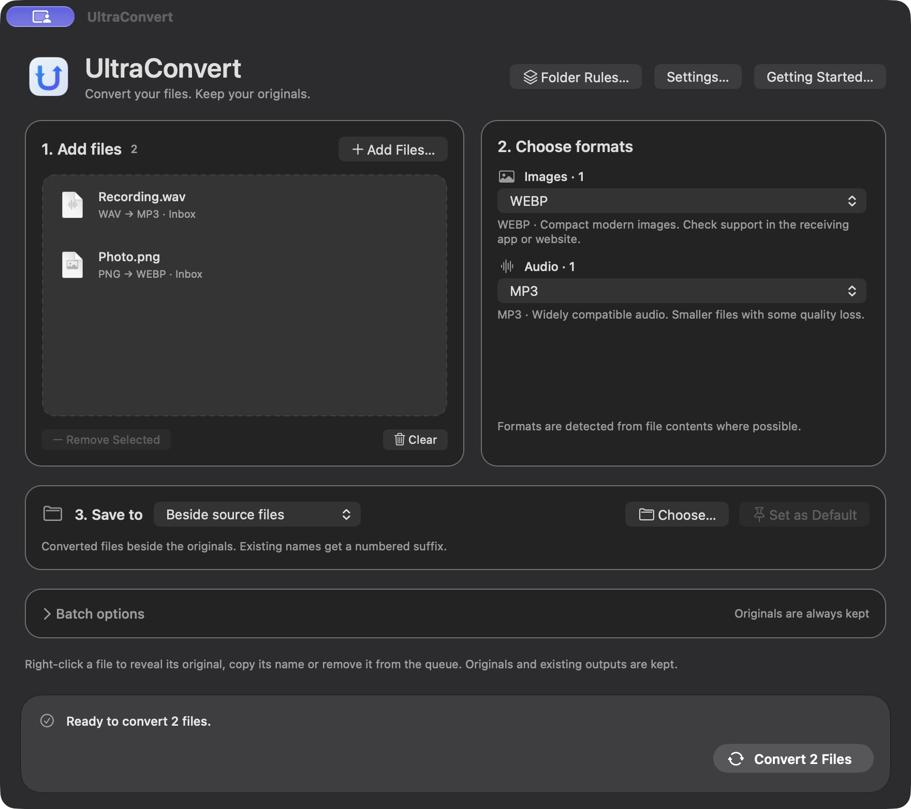
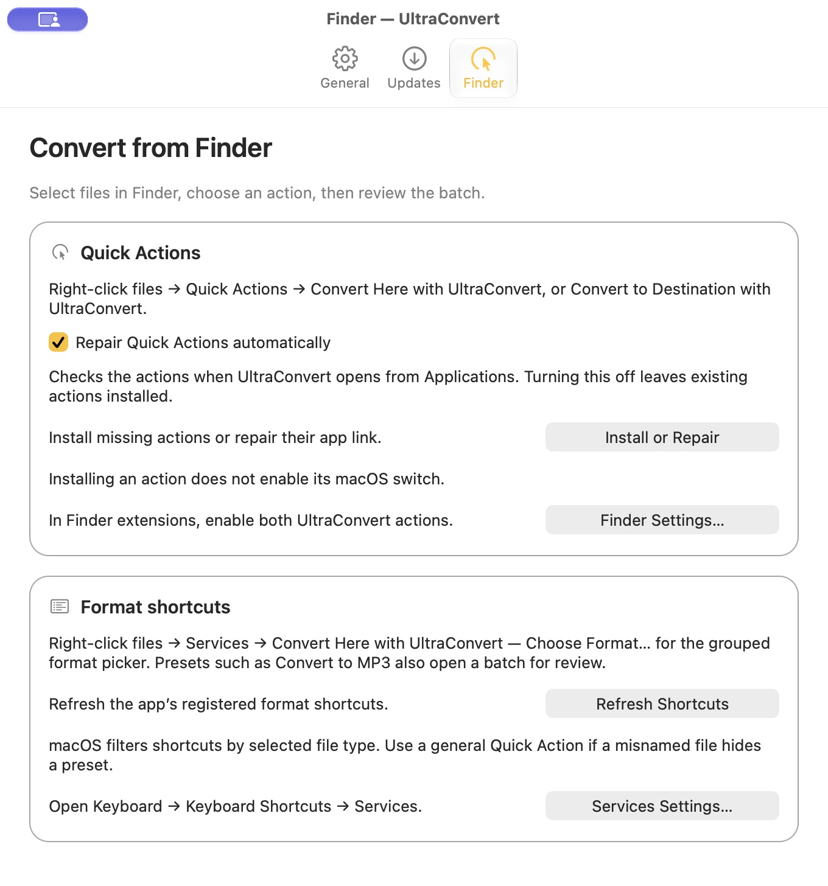
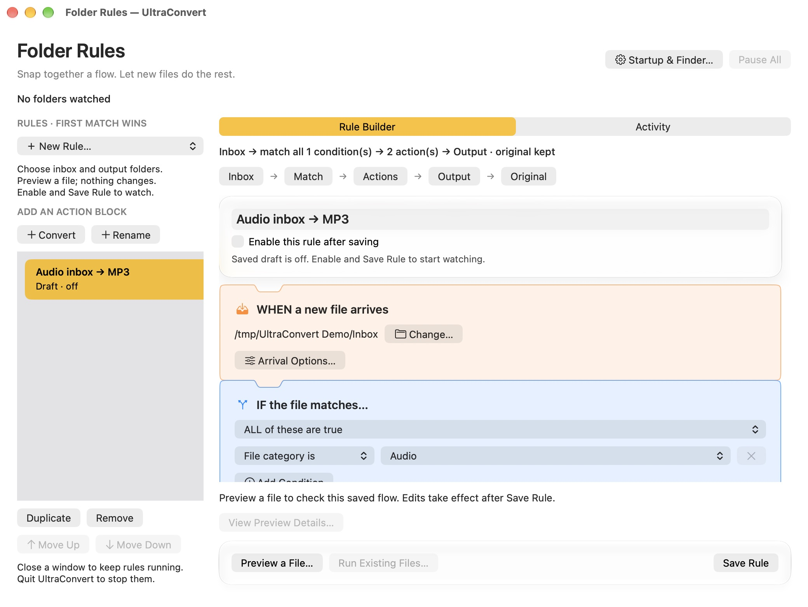
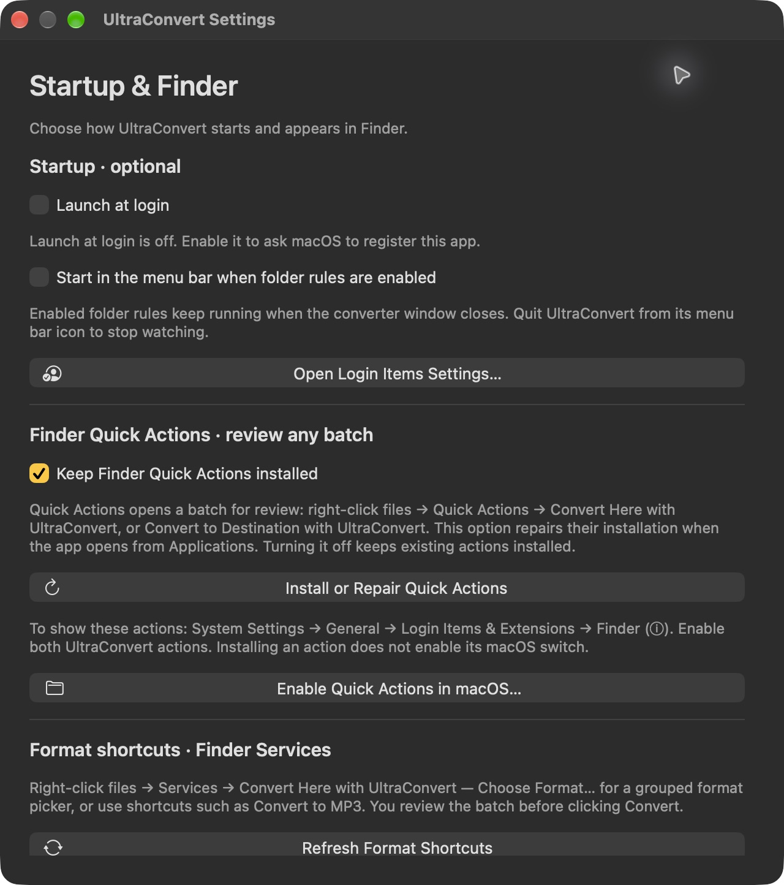
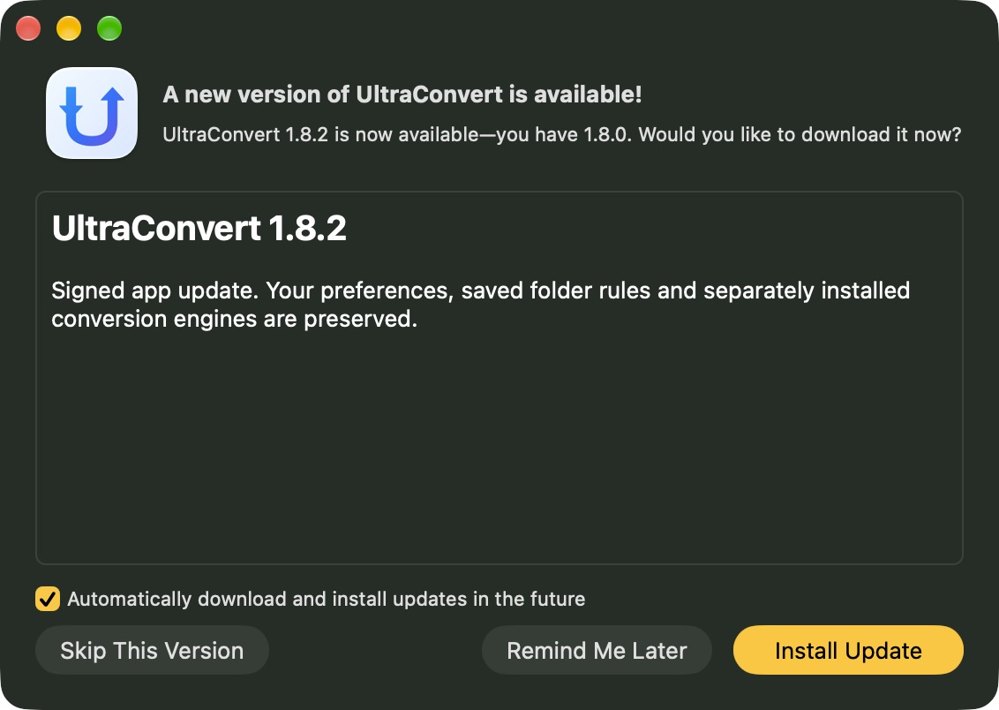
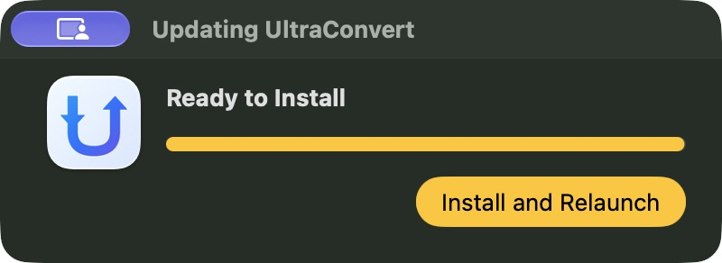
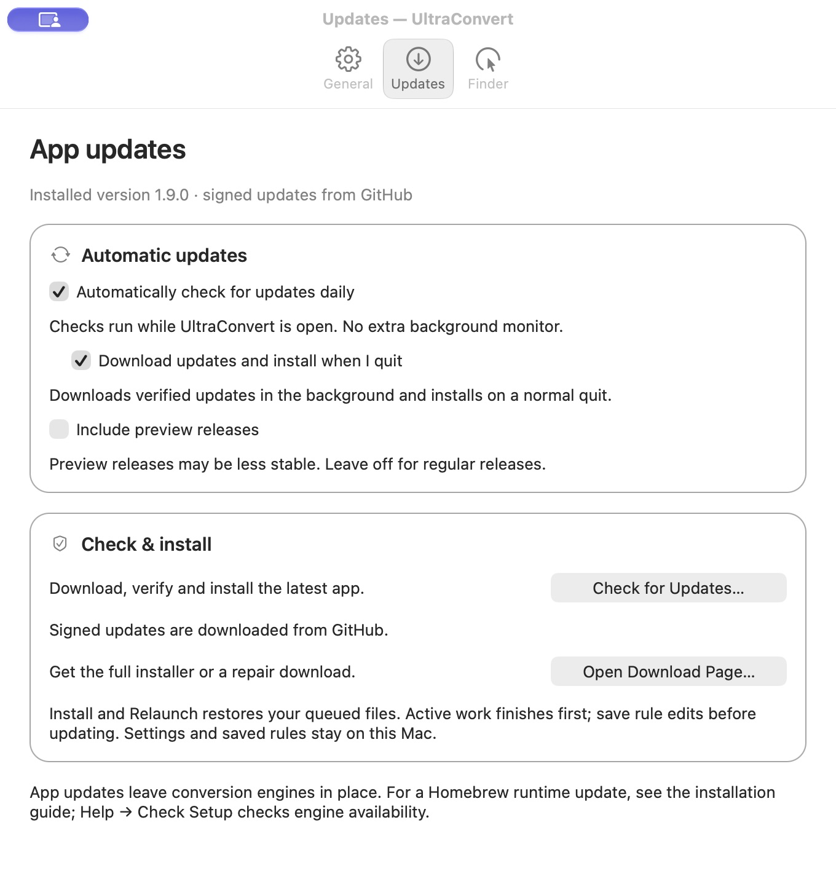

<p align="center"></p>
<h1 align="center">UltraConvert</h1>
<p align="center">Convert files locally on your Mac. Keep your originals.</p>
<p align="center"><a href="https://github.com/samuel-zhang01/UltraConvert/actions/workflows/ci.yml"></a> <a href="LICENSE"></a></p>

UltraConvert is a native **Swift/AppKit macOS app** for images, audio, video, documents, ebooks, maps and structured data. Add one file or a mixed batch, choose compatible formats, and save beside the originals or in another folder. Conversion runs locally; no account, upload service or telemetry.

**Start with manual conversion.** Finder shortcuts and automatic folder rules are optional.



Example: WAV → MP3 with optional Custom quality enabled. It is off by default.

[Install](#install) · [First conversion](#convert-your-first-file) · [Finder](#convert-from-finder) · [Folder rules](#automate-a-folder) · [Startup](#startup-and-settings) · [Updates](#update-or-remove) · [Formats](#supported-formats) · [Help](#help-and-troubleshooting)

## Install

The **[latest release](https://github.com/samuel-zhang01/UltraConvert/releases/latest)** includes a **Developer ID signed, Apple-notarized universal app** for Apple Silicon and Intel, with in-app updates. Intel compilation is verified; Intel hardware and engine installation remain untested. Check **RELEASE-METADATA.json** and **SHA256SUMS.txt** for the package you download. The app’s notarization ticket is stapled; the signed DMG is not separately notarized.

### Homebrew installation

```sh
brew tap samuel-zhang01/ultraconvert
brew install --cask ultraconvert
```

The custom tap installs the signed app into Applications, a conversion-runtime formula and its engine dependencies. Open the app once, then enable Finder actions as described below. This tap is maintained by UltraConvert and is not an official Homebrew Core/Cask submission. Its release gate checks the recipes, public downloads and signatures on the maintainer’s Mac. Real installation and upgrade tests are run separately with explicit authorization, preserving saved preferences and rules.

**Already installed in `/Applications`?** Quit the app, then use `brew install --cask --adopt ultraconvert`. Homebrew checks the existing app instead of overwriting a conflicting copy. Keep one app in Applications; a manual `~/Applications` copy should be moved to `/Applications` before adoption.

Use **Check for Updates…** for app updates. Use `brew upgrade ultraconvert-runtime` for the conversion runtime. Existing manual installations retain their working per-user environment. Normal `brew uninstall --cask ultraconvert` preserves preferences, folder rules and converted files; shared engines and the runtime remain installed. [Tap guide](https://github.com/samuel-zhang01/homebrew-ultraconvert).

**Update with Homebrew instead:** finish active work and quit UltraConvert, then run these in order:

```sh
brew update
brew upgrade samuel-zhang01/ultraconvert/ultraconvert-runtime
brew upgrade --cask --greedy samuel-zhang01/ultraconvert/ultraconvert
```

Open UltraConvert from Applications afterward. The runtime-first order protects Finder actions when upgrading an older cask; `--greedy` explicitly includes the app even when it has its own updater. Settings and folder rules stay in place. Finish or clear any queued batch before quitting: Homebrew does not perform the in-app updater’s queue restoration.

Normal cask removal also retains Finder actions so upgrades can preserve them. To remove this app’s owned actions as well, use `brew uninstall --zap --cask ultraconvert`; this tap’s optional cleanup still preserves preferences, saved rules, converted files and unrelated Finder actions.

### Manual installer

The app uses separately installed open source conversion engines. **Dragging the `.app` into Applications alone does not install those engines.** This installer sets up the app, engines and Finder actions:

1. Install [Homebrew](https://brew.sh), including its printed **Next steps**. Open a new Terminal window and confirm `brew --version` works.
2. Download the **UltraConvert-VERSION-macos-universal.zip** installer from the [latest release](https://github.com/samuel-zhang01/UltraConvert/releases/latest), replacing VERSION with its release number. Use the named installer ZIP. The **DMG** contains the same installer folder: open it, copy **UltraConvert** into Downloads, then eject the disk image. The `update-macos-universal.zip` asset is for the in-app updater and requires an existing engine installation. GitHub’s automatic “Source code” downloads are for developers.
3. Double-click the ZIP. Open **Terminal**, type `cd ` with a trailing space, drag the extracted **UltraConvert folder** into Terminal, and press Return.
4. Run:

   ```sh
   python3 install.py
   ```

5. Wait for **Installed app** and **Next steps**. First setup can take several minutes and download substantial dependencies. Then open UltraConvert from Spotlight or Applications.

The native app targets macOS 13+. Hands-on checks run on Apple Silicon/macOS 27; conversion-engine support may require a newer system. The same universal ZIP contains both CPU versions; [building from source](#build-from-source) is also available. Intel hardware and engine operation are unverified.

### Build from source

Install Homebrew first. If Apple’s Command Line Tools are missing, run `xcode-select --install` and finish Apple’s installer. Then:

```sh
git clone https://github.com/samuel-zhang01/UltraConvert.git
cd UltraConvert
python3 install.py --build-from-source
```

The installer accepts macOS’s Python 3.9 bootstrap and provisions Homebrew Python for conversion. New installs use `~/Applications/UltraConvert.app`; updates reuse the managed copy in `/Applications` or `~/Applications`. Runtime and rules live in `~/Library/Application Support/UltraConvert`.

## Convert your first file

1. **Add files:** click **Add Files…** (⌘O), or drop files into the window. Recognition uses file contents where possible.
2. **Choose formats:** pick an output for each detected category, such as audio → MP3 and photos → WebP. Advice below each choice explains the format.
3. **Save to:** leave **Beside source files** selected for results directly beside the originals. For another folder, select a destination and click **Choose…**.
4. Click **Convert**. **Show Results** reveals the outputs; **Report** opens readable results, full errors and preservation notes; **Reveal Report…** locates the original JSON.

Manual conversion keeps originals and existing outputs. Name collisions get numbered suffixes, such as `Recording (2).mp3`. Formats with companion files use one folder to keep their resources together. With **Beside source files**, different source folders retain their respective results.

**Batches:** add multiple files at once. Mixed types get separate format selectors; up to 1,000 files can share a batch. **Remove Selected** and **Clear** remove queue entries without deleting files.

**Quality and size:** for a supported lossy output, turn on **Custom quality** below its format picker. Drag toward **Smaller** or **Higher quality**; each image/audio/video group has its own setting. Leave it off to use the established encoder defaults. Audio shows a size estimate from duration and target bitrate; actual size varies. Image and video size depends on content and cannot be predicted reliably before encoding. A setting of 100 can still be lossy and cannot restore missing source detail. Custom media profiles use 48 kHz audio. Lossless outputs keep their standard profile. **Skip files already in target format** takes priority and skips re-encoding, including custom quality.

**Save-location reminder:** the bottom bar always shows where the next batch will save. Click **Save location…** to jump to its controls, including in a compact window.

**Saved destination:** choose a folder, then click **Set as Default**. Each destination batch gets a fresh folder there. The initial default is `~/Downloads/UltraConvert`.

## Convert from Finder

Enable the actions once:

1. Open **UltraConvert → Settings… → Finder → Finder Settings…**.
2. In **System Settings → General → Login Items & Extensions**, find **Finder** under Extensions and open its information button.
3. Enable **Convert Here with UltraConvert** and **Convert to Destination with UltraConvert**. Older macOS versions place these under **Extensions → Finder**.



Select one or more files in Finder, right-click, and use:

| Menu item | Result |
| --- | --- |
| **Quick Actions → Convert Here with UltraConvert** | Review a batch that saves beside each original. |
| **Quick Actions → Convert to Destination with UltraConvert** | Review a batch using your saved destination. |
| **Services → Convert to MP3 / Opus / MP4 / PNG / JPEG / WebP with UltraConvert** | Review a batch with a common target preselected. |
| **Services → Convert Here with UltraConvert — Choose Format…** | Choose a category and format from all supported targets. |

**Review the formats and click Convert in the app.** Shortcuts do not silently start conversion. Both Quick Actions support multiple files.

Enable Services separately in **System Settings → Keyboard → Keyboard Shortcuts → Services**. macOS controls which appear for a selection and does not provide nested Services/Quick Actions menus; UltraConvert uses a grouped format picker. [More Finder help](docs/USAGE.md#enable-the-finder-actions).

## Automate a folder

Open **Folder Rules…** in the main window. Rules watch folders you choose and run while UltraConvert is open.



Start with **＋ New Rule… → Audio → MP3**, then follow the pieces:

| Piece | Choose |
| --- | --- |
| **WHEN** | An inbox folder for incoming files. |
| **IF** | Formats, categories or filenames. **ALL** requires every condition; **ANY** requires at least one. |
| **DO** | Convert/Rename actions, run top to bottom. Add from the left palette; drag grips or use Move Up/Down. |
| **SAVE** | An existing output folder outside every enabled inbox. |
| **AFTER SUCCESS** | **Keep the original** to start. Archive or Trash requires explicit acknowledgement. |

Click **Preview a File…** with a real inbox file. Preview changes no files; **View Preview Details…** shows the full plan. Block illustrations use a sample format; Preview checks your actual file.

When ready, select **Enable this rule after saving** and click **Save Rule**. Add a new file to the inbox, then inspect **Activity**. New rules start disabled; edits take effect only after saving.

Existing files are ignored when watching starts or resumes. To process them deliberately, wait for **Run Existing Files…**, then review its confirmation. Its reported count is the actual accepted count within the 1,000-file total queue limit. Repeated requests prioritise files not yet handled during the current watching session.

Rules run in priority order. A nonmatch tries the next eligible rule. A failed conversion keeps the original and does not try another rule. **Pause** stops watching. Closing the main window keeps enabled rules running; **Quit UltraConvert** stops the app.

[Full folder-rule guide](docs/USAGE.md#folder-rules): settling time, subfolders, rename tokens, archive/Trash handling, limits and recovery.

## Startup and settings

Open **UltraConvert → Settings…** (⌘,).

Settings has three native panes: **General**, **Updates** and **Finder**. It reopens the pane you last used. The actions share one aligned button column; their results appear beside the relevant controls.



Navigation uses short, consistent native transitions. UltraConvert respects **System Settings → Accessibility → Display → Reduce motion**; enable it for immediate transitions.

- **Launch at login:** opens UltraConvert when you sign in; off by default. Check any approval requested by macOS.
- **Start minimized at login:** in **General**, enable Launch at login first, then select this option. The converter stays closed at login; the menu bar icon offers **Open Converter**, **Settings** and **Quit**, even without saved folder rules. Opening files or recovering an in-app update still shows the converter. Off by default.
- **Folder-rule startup → Open quietly with active folder rules:** retains the earlier optional behavior on other launches while enabled rules run.
- **Finder → Install or Repair:** restores the two owned Quick Actions using this app’s location. **Repair Quick Actions automatically** checks them when the installed app opens; turning it off leaves existing actions installed.
- **Finder → Refresh Shortcuts:** registers preset Services; open **Services Settings…** to enable their switches separately.

Full Disk Access and Accessibility are not setup requirements. Use native pickers and respond to macOS access prompts for the locations you choose.

## Supported formats

| Category | Formats |
| --- | --- |
| Images | png, jpg, jpeg, heic, webp, tiff, bmp, ico, icns, avif |
| Audio | mp3, wav, flac, aac, m4a, ogg, wma, aiff, alac, opus, ape, wv |
| Video | mp4, mov, webm, mkv, avi, gif, m4v, 3gp, flv, ts, mts, m2ts, wmv, ogv, mpg, mpeg, mxf, vob |
| Documents / ebooks | docx, odt, rtf, md, html, tex, epub, mobi, azw3 |
| Geospatial | geojson, gpkg, shp, kml, kmz, gpx, gml, wkt |
| Structured data | json, yaml, yml, plist, toml |

Conversions stay within compatible categories; video can also become audio. All formats passed representative round trips. Complex layouts, every codec and metadata are not guaranteed; see [preservation limits](docs/USAGE.md#preservation-limits). DRM-protected ebooks are unsupported; TeX is parsed without execution.

Engines: FFmpeg/FFprobe, ImageMagick, GDAL/OGR, Pandoc, Calibre, Monkey’s Audio and pinned Python parsers. Public packages install them separately with their upstream licences. A full engine-bundled development app/DMG remains unpublished pending distribution review.

## Help and troubleshooting

| Problem | First check |
| --- | --- |
| `brew: command not found` | Complete Homebrew’s shell setup, then open a new Terminal window. |
| Terminal cannot find `install.py` | Repeat `cd ` + drag-folder. Choose the folder containing `install.py`. |
| Missing runtime/engine | Open **Help → Check Setup…**; rerun the current installer if needed. |
| Finder action missing | Check Finder enable switches, select files, and reopen the Finder window. |
| Rule did not run | Check saved/enabled state, Pause, Activity and whether the file predates watching. |
| Some files failed | Read each error in **Report**. Other files can still succeed. |
| Several app copies appear | Use the installer’s reported location. Updates reuse the managed app; build artifacts are not installed copies. |

Reopen **Getting Started…** for the offline guide. [Full usage and troubleshooting](docs/USAGE.md) · [Command-line usage](docs/USAGE.md#command-line).

[Report unresolved bugs](https://github.com/samuel-zhang01/UltraConvert/issues) with app/macOS versions, format pair and relevant error. Redact local paths before sharing reports.

## Update or remove

**From version 1.8 onward, update inside the app:**

1. Choose **UltraConvert → Check for Updates…**, or open **Settings → Updates** (⌘,) and click **Check for Updates…**.
2. Read the release notes and click **Install Update**. Keep the app open while the download is verified and prepared.
3. Click **Install and Relaunch**. UltraConvert installs the update and reopens with your queued files, selected formats and destination.

Your preferences, saved folder rules and conversion engines are retained. Active conversions and previews finish first; save or discard any rule edits before updating. If you already have the newest version, the app says **You’re up to date!**.





These screenshots show real update tests; version numbers change with each release. [Download preparation](docs/images/update-progress.png) · [Restored file queue after relaunch](docs/images/update-restored-queue.png).



**Automatic updates:** **Settings → Updates** has three options:

- **Automatically check for updates daily** is on by default. Checks run while UltraConvert is open; no separate background monitor is installed.
- **Download updates and install when I quit** is optional and off by default. It downloads verified updates in the background and installs on a normal quit. You can still use Check for Updates to install and relaunch sooner.
- **Include preview releases** is optional and off by default for this full release. Stable releases remain available in either setting.

The Settings screenshots show example preferences; login, minimized startup and background installation are your choices.

**Coming from 1.7 or earlier, repairing engines, or updating manually:** quit UltraConvert, extract the full installer ZIP (or copy its folder out of the DMG), and run `python3 install.py` from that folder once. Future app updates are available in the menu. Source installs can use `git pull --ff-only` followed by `python3 install.py --build-from-source`. The manual installer backs up old components and rolls back failed component swaps.

In-app updates include the native app and its conversion code. Conversion engines are maintained separately. For a Homebrew installation, use `brew upgrade ultraconvert-runtime` and **Help → Check Setup…**. For a manual installation, rerun the full installer if an engine needs repair. Update checks contact GitHub, but send no input files or saved rules. Sparkle system profiling is disabled.

If an update fails, the existing app remains installed. Try Check for Updates again when online, or use the full installer ZIP. Running from a disk image or a read-only location can prevent updates; install using the instructions above first.

**Remove:** quit the app and run `python3 uninstall.py` from the release/source folder. Owned app, workflows and runtime move to Trash. Shared Homebrew engines and converted files remain.

## Development and verification

[Contributing](CONTRIBUTING.md) · [Security](SECURITY.md) · [UX audits](docs/UX-AUDIT.md) · [Release/signing](docs/MACOS-RELEASE.md) · [Source research](research/REVIEW.md) · [Homebrew verification](evidence/homebrew-verification.json) · [Real GitHub update verification](evidence/github-update-verification.json).

On an Apple Silicon Mac running macOS 27, real production GitHub updates **1.8.0 → 1.8.2 → 1.8.3** downloaded, installed and relaunched successfully. Both retained the queued file, MP3 choice, destination, all 11 persistent preferences and the saved folder rule unchanged. A conversion after the first update passed and kept its original. Local Homebrew runtime installation, conversion tests, app adoption and data preservation also passed; fresh hosted Homebrew installation/removal tests and the automatic release pipeline passed.

CI checks native compilation, format round trips, edge cases, malicious input, installer rollback and static/dependency security. Matching version tags automatically create the signed and notarized release, verify public downloads, run inline Homebrew style and online recipe audits, and verify the exact published tap before publishing the signed update feed. Signing runs on the maintainer’s Mac, which must be awake with its Keychain accessible; all project-defined jobs use the registered maintainer Mac with no hosted fallback. GitHub’s free managed dependency checks are separate; see [local CI](docs/local-ci.md). Public pull requests do not trigger automatic jobs; external changes need review in a disposable environment before merging. Signing and notarization establish artifact status, not functional perfection. Original code/artwork are MIT licensed; upstream snapshots retain their licences.

## Licence and upstream source

UltraConvert’s original code and artwork use the [MIT licence](LICENSE). [Sparkle](https://github.com/sparkle-project/Sparkle) provides signed app updates; its complete licence is included at `UltraConvert.app/Contents/Resources/Sparkle-LICENSE`. Conversion engines are installed separately and retain their upstream licences. The [source review](research/REVIEW.md) links the upstream projects and explains which code is used; research snapshots retain their own licence files.
