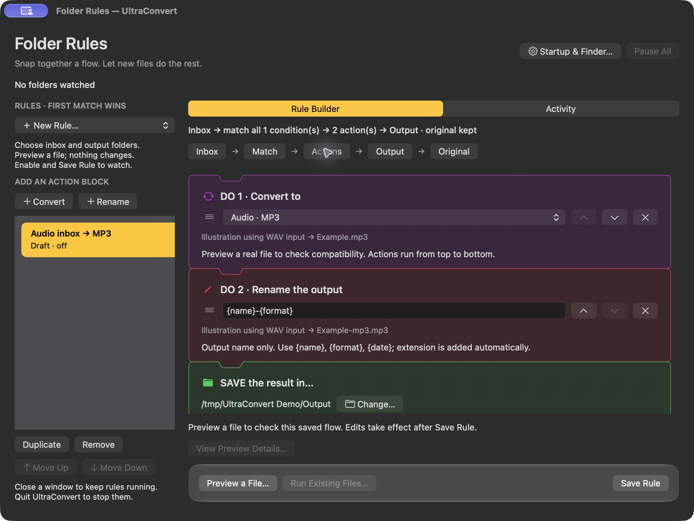

# UltraConvert usage guide

[Back to the quick-start README](../README.md) · [Installation](../README.md#install)

## Enable the Finder actions

1. Open **System Settings → General → Login Items & Extensions**.
2. Scroll to **Extensions**. Find **Finder** and click its **ⓘ** information button.
3. Turn on **Convert Here with UltraConvert** and **Convert to Destination with UltraConvert**.
4. Click **Done**. Select a supported file in Finder, right-click and open **Quick Actions**.

On older macOS releases, look in **Extensions → Finder**. You can reach Login Items & Extensions from **UltraConvert → Help → Finder Action Settings**; then open the Finder list. [Apple's Quick Action guide](https://support.apple.com/en-gb/guide/automator/aut73234890a/2.10/mac/15.0) explains the system feature.

Both workflows carry UltraConvert's logo as a custom Quick Action image and Finder document icon. The logos have been verified beside both enabled actions in macOS 27's Finder Settings list. Other permission dialogs decide their own layout and may identify the Automator runner rather than the app. UltraConvert's app bundle also includes its branded icon for surfaces that show app identities.

For ordinary use, select files or folders through the native pickers and respond to any macOS access prompt for the location you chose. **Full Disk Access and Accessibility are not setup requirements.** If a folder-access prompt was denied, check **System Settings → Privacy & Security → Files & Folders** for the named requester. Do not enable unrelated permissions to make an icon appear.

## Your first conversion

Start in the app; Finder shortcuts are optional:

1. Open **UltraConvert** from Spotlight or Applications. The first-use **Getting Started** guide explains conversion, Finder, folder rules and startup; you can reopen it from the main window or **Help → Getting Started**.
2. Click **Add Files…** (⌘O) or drop one or more files into **1. Add files**. UltraConvert recognises their contents and shows compatible targets.
3. In **2. Choose formats**, pick an output for each category. The advice below each choice explains uses and tradeoffs; for example, MP3 is widely compatible compressed audio, while FLAC is lossless.
4. Review **3. Save to**. **Beside source files** keeps ordinary results beside each original; **Choose destination** selects an output folder.
5. Click **Convert**. **Show Results** reveals the new files; **Report** explains failures or skipped files. Originals and existing outputs are kept.

Once comfortable, select files in Finder → right-click → **Quick Actions → Convert Here with UltraConvert** for the same review flow, or **Convert to Destination with UltraConvert** for your saved output folder.

For a mixed selection, one format selector appears for each detected category. For example, photos → WEBP, audio → OPUS, documents → DOCX and GIS → GPKG can share one batch. Video can also be converted to audio, such as MP4 → MP3 or OPUS. Unsupported files are identified; valid files can still be converted.

You can also open **UltraConvert** from Spotlight or Applications, drag files into the queue or click **Add Files…**, and use the same controls. Adding files appends to the queue and ignores repeats. Select queue rows and click **Remove Selected** (or press Delete); **Clear** empties the queue. These actions do not delete your original files. **Help → Getting Started** works offline. The full guide opens this detailed usage guide in your browser.

Batches accept up to **1,000 files**. Content probing recognises many misleading extensions; ambiguous plain text still needs an extension hint. Select a Shapefile's `.shp` file with its matching `.dbf`, `.shx` and optional `.prj` nearby. Selecting those sidecars together produces one dataset conversion.

For a common format, right-click → **Services → Convert to … with UltraConvert**. PNG, JPEG and WebP appear for images; MP3 and Opus for audio/video; MP4 for movies. macOS filters these shortcuts by the file type known to Finder. They open the app with that format selected and **Beside source files** chosen. Review the batch, then click **Convert**. A preset that does not suit every selected file leaves Convert disabled until you explicitly choose compatible per-category formats. They reuse an idle app window; if a batch is busy, wait or cancel before trying again. The two general Quick Actions open a fresh window with their chosen destination mode.

If a format shortcut is missing, check **System Settings → Keyboard → Keyboard Shortcuts → Services** and enable the named UltraConvert shortcut. For a misleading extension or a mixed selection that Finder cannot categorise, use the general Quick Actions or Add Files; content inspection still runs in the app.

For every supported target, use **Services → Convert Here with UltraConvert — Choose Format…**. Pick Audio, Video, Images, Documents, Geospatial or Structured data, choose a format and click **Review Conversion**. The app recognises the selection and checks compatibility before you click Convert. In the app, right-click a queue row → **Review Only Selected Files Here as → category → format**; only formats compatible with every selected file are shown. This prepares the selected files for review; click Convert to start.

macOS does not expose nested submenus through Quick Actions or Services. [Apple documents that Services have no submenus](https://developer.apple.com/library/archive/documentation/Cocoa/Conceptual/SysServices/Articles/properties.html). A custom nested Finder menu would require a separately enabled Finder Sync extension scoped to selected folders; this preview uses supported Services and the grouped picker.

## Choose where results go

| Choice | What happens |
| --- | --- |
| **Convert Here with UltraConvert** / **Beside source files** | Places ordinary converted files directly beside their originals, without a batch folder. Files from different folders stay beside their respective sources. |
| **Convert to Destination with UltraConvert** / **Saved destination** | Starts with your saved default folder, initially `~/Downloads/UltraConvert`. All results go into one fresh batch folder there. |
| **Choose destination…** or **Choose…** | Opens a folder picker. Select or create a folder, click **Open**, then click **Convert**. Cancelling the picker starts no conversion. |

To change the default: click **Choose…**, select a folder, then click **Set as Default**. The path displayed below the controls confirms where outputs will go. **File → Open Default Destination** opens the saved folder in Finder.

For **Convert Here**, an existing output name gets a numbered suffix, such as `Recording (2).mp3`. Formats requiring multiple companion files or linked media use one adjacent folder, such as `Note-html`, to preserve their references. Destination conversions create a fresh batch folder. Existing outputs and originals are never overwritten. UltraConvert remembers your output formats and options for the next run; the Finder action sets the initial destination mode for that window.

## Startup and Finder settings

Open **UltraConvert → Settings…** or press **⌘,**.

- **Launch at login:** off by default. Turning it on asks macOS to open the app at your next login. The status reflects macOS's current state, including any approval needed in **Login Items**. Turning it off unregisters the login item. Finder conversion works with this option off.
- **General → Start minimized at login:** off by default and available when Launch at login is enabled or awaiting macOS approval. At a login launch the converter stays closed. Its menu bar icon remains available even without rules, with Open Converter, Settings and Quit. Opening files or restoring an app update takes precedence and shows the window. Disabling login retains the minimized preference for next time.
- **General → Folder-rule startup → Open quietly with active folder rules:** retains the older optional startup behavior when rules are running. Explicitly opening files still shows the converter.
- **Finder → Repair Quick Actions automatically:** on by default. Opening an installed app from Applications checks/repairs its two owned Quick Actions. Turning it off leaves existing actions available and stops automatic registration.
- **Finder → Install or Repair:** restores the two owned workflows and points them at this app's actual location. It preserves earlier owned workflows in backups and refuses unrelated actions. Wait for any conversion to finish first.
- **Finder → Refresh Shortcuts:** registers this app and refreshes its preset shortcuts and the all-format Choose Format service.
- **Finder Settings… / Services Settings…:** open the relevant macOS settings pane. For Services, open **Keyboard Shortcuts → Services** and enable the named shortcuts. Registration does not change macOS's enable switches.

General, Updates and Finder use a native toolbar. The selected pane is remembered. Repair/refresh results appear in their own section; disabled options explain what must be enabled first.

## Quality and estimated sizes

Below a supported image, audio or video format selector, enable **Custom quality**. Each source category has an independent slider. Leaving it off preserves the existing encoder profiles. Quality runs from 1 (smaller) to 100 (higher quality), using each codec’s native quality or bitrate setting; it is not a percentage of the original file’s size, and 100 does not guarantee losslessness.

Supported custom images: JPEG/JPG, WebP, AVIF and HEIC. Supported custom audio: MP3, AAC/M4A, Opus, OGG and WMA. Most video formats use custom quality; GIF and MXF keep their fixed profiles. Lossless and document/data/geospatial targets keep their standard profiles.

Audio estimates use the total known duration and target bitrate. They are estimates of encoded audio, not size guarantees; codec behavior and container overhead affect actual size. If duration is unknown, no numeric estimate is shown. Image/video output depends on content, so the app explains why a reliable estimate is unavailable. Custom media profiles use 48 kHz audio to avoid unsupported bitrate combinations on low-rate voice notes; channel count is preserved. Raising quality cannot recover detail already missing from a source.

**Skip files already in target format** skips re-encoding even when custom quality is enabled. Turn it off to recompress an existing MP3/JPEG/etc. Manual conversions continue to keep originals. Folder rules retain their existing encoder defaults; these sliders apply to manual batches.

## Folder rules

Use the stage buttons above the pieces to jump to Inbox, Match, Actions, Output or Original. The footer stays available while the canvas scrolls.



1. Open **Folder Rules…** in the converter, or **UltraConvert → Folder Rules…**.
2. Choose a template from **＋ New Rule…**: **Audio → MP3**, **Images → WebP**, **Data → YAML**, or a blank rule. New rules start as disabled drafts.
3. In the orange **WHEN** puzzle piece, choose an inbox. **Arrival Options…** reveals **Include subfolders** and the stable-file wait (2–120 seconds). Files must stop changing for that time before they run.
4. In the blue **IF** piece, choose **ALL** or **ANY** and add detected format/category or filename conditions. Recognition uses file content where possible. Filename tests are case-insensitive and include the original extension. **MATCH** follows the action stack; **NO MATCH** tries the next eligible enabled rule. If none matches, the file stays unchanged.
5. Use **ADD AN ACTION BLOCK → Convert / Rename** to extend the purple/pink action stack. Drag a block's grip above or below another action to snap it into place, or use its **Move Up/Down** buttons. Actions run top to bottom. Rename accepts `{name}`, `{format}` and `{date}` without an extension. Each block shows a live filename illustration; `{format}` uses the format at that step, so renaming before converting can produce a different name. Preview a real file to check its actual plan. Sequential conversions support single-file results; companion bundles need one conversion block.
6. In **SAVE**, choose an existing output folder outside every enabled watch folder. Results are direct files unless companion resources need one folder. Name collisions get numbered suffixes.
7. Leave **Keep original in inbox** selected, or explicitly choose **Move original to archive** / **Send original to Trash** and check the acknowledgement. Archive folders must also stay outside watch folders. These actions happen only after successful publication and a source-integrity check; failure/cancellation/changed-source cases keep the original. GIS and document originals must be kept because they may have companion files. They also need a conversion block when routing to preserve those companions. Trash is recoverable through Finder. If a source name is replaced during a failed final action, the earlier original is retained in a hidden recovery folder; Activity identifies its full path. Copy that path into Finder’s Go → Go to Folder to recover it without replacing the new file.
8. Click **Preview a File…** and choose an inbox file. This only recognises it and shows a plan; it changes no files. Use **Cancel Preview** or **Escape** to stop it. Editing or switching a rule invalidates an in-progress test, so old results cannot appear as the current plan. Test previews also refuse linked/changed sources and unsafe document/GIS original actions. Use **View Preview Details…** for the full source/output/archive paths and original-file consequence, even when the summary is long. Editing invalidates completed details. Check the plan, turn on **Enable this rule after saving**, then click **Save Rule**.
9. Add a new file to the inbox. **Activity** shows outcomes and offers **Reveal Output**. **Details…** opens the full selectable message, paths and recovery instructions. At most 200 local activity entries are retained.

Rules run top to bottom: the first matching enabled rule handles each file. **Move Up/Down** changes priority. **Duplicate** creates a disabled copy. Rule edits take effect only after saving. When leaving an edited rule, choose **Save Changes**, **Keep Editing** or **Discard Changes**. Discard restores the saved rule; a failed save keeps the editor open. Saving changes to enabled rules, resuming or restarting establishes a fresh baseline: existing inbox files are ignored. **Run Existing Files…** becomes available when the watcher finishes its initial scan. It queues current files using the saved rules, including their original-file policy, and reports the actual accepted count. Requests respect the 1,000-file total queue capacity, skip already queued/running files, and prioritise files not yet handled during the current watching session. Run it again after completion to reach remaining files in larger inboxes. A conversion failure keeps the original and does not try a lower-priority rule. Pause persists across app restarts. Pausing ignores arrivals until resumed; it does not build a hidden backlog.

The menu bar icon offers **Open Converter**, **Folder Rules**, **Pause/Resume**, **Settings** and **Quit**. Closing the converter keeps enabled rules running. **Quit UltraConvert** stops watching and waits for an active automation conversion to cancel. Enable **Launch at login** in Settings if you want watching to resume when you sign in. A second UltraConvert instance can perform manual conversions but cannot run another watcher on the same rules.

Automation watches only folders you select. Hidden/temporary files, symlinks, hard links and package contents are skipped. Limits are 32 rules, 12 conditions and 8 steps per rule, 20,000 observed files, 40,000 recursive traversal entries and 1,000 queued candidates. Use a small inbox rather than your entire home or library. Files arriving while the app is closed are not automatically processed at restart. Use Run Existing Files when you intend to process them.

The watcher uses native filesystem events. It has **no polling timer or conversion engine process while idle**; one automation file converts at a time, and new automation jobs wait while a manual batch is busy. Conversion CPU/RAM depends on the engine and input; large media/GIS files can still be expensive. Rules and bounded activity are stored locally in `~/Library/Application Support/UltraConvert/Automation/`; they can contain folder paths, so review them before sharing.

## Useful controls

- **Skip files already in target format:** matching files stay at their original location and are recorded as skipped. They are not copied to the output folder.
- **Batch options:** expand this row to show skip-matching, concurrency and automatic result opening.
- **1–4 files at a time:** converts that many files at once. Two is the default. Use one for large media or GIS inputs to reduce memory pressure; four can help batches of small files.
- **Open results when finished:** reveals converted files for Convert Here, or opens the destination batch folder, after completion.
- **File-row right-click:** choose a target through **Review Only Selected Files Here as → category → format**, reveal the original, reveal its converted result, copy file names or error details, or remove the selected rows from the queue. Removing rows keeps the files on disk.
- **Retry Failed:** loads only failed files, recognises them again and lets you review formats/destination before another conversion.
- **Cancel:** stops the current batch. Completed outputs and the partial batch report are retained.
- **Report:** opens a read-only native window with per-file outcomes, full errors, preservation notes and file locations. **Copy Report** copies that readable text locally; redact paths before sharing it. **Reveal Report…** selects the original JSON report in Finder. Convert Here keeps reports under `~/Library/Application Support/UltraConvert/Reports/` to avoid cluttering your source folders. Destination batches keep `conversion-report.json` in their batch folder.
- **File → Copy Result Summary:** copies counts for the last completed batch, without source paths.
- **Help → Check Setup…:** checks installed engine versions, Python/GDAL imports, native icon tools and workflow files locally. It does not inspect your selected files, upload a report or confirm Finder's enable switches. **Copy Setup Report** is optional.
- **Keyboard:** ⌘O adds files; ⌘Return converts here; ⇧⌘Return chooses a folder and converts. Ordinary Return activates Convert. ⌘Z / ⇧⌘Z undo/redo text edits; ⌘X cuts selected text; ⌘W closes the current window with its normal unsaved-change guard. Escape cancels the format chooser or an active rule test.
- **Geospatial CRS:** enter the known input coordinate system, for example `EPSG:4326`, when required. Bare WKT needs a known CRS; do not guess one.

File rows preview the source → target format. Unsupported and failed files have concise labels, with full diagnostics in their tooltip, Copy Error Details and Report. A skipped-only batch keeps Report available and hides Show Results.

The file queue and output-format list scroll independently. The conversion bar keeps progress, Convert, Cancel and completed-batch actions visible. Expand **Batch options** for less frequently used controls; the main area scrolls on smaller screens. File and folder pickers remember useful starting locations. On macOS 26+, the action bar uses native Liquid Glass; older systems use a native material fallback.

## Troubleshooting

| Problem | What to do |
| --- | --- |
| `brew: command not found` or installer asks for Homebrew | Complete Homebrew's printed shell setup, open a new Terminal window, and retry `brew --version`. |
| `can't open file … install.py` | Terminal is in the wrong folder. Repeat the `cd ` + drag-folder step; the folder must contain `install.py`. |
| App blocked by macOS, or prebuilt has the wrong architecture | Run `python3 install.py --build-from-source` in the release folder after installing Command Line Tools. Use the universal package when available; otherwise build from source on Intel. |
| Quick Actions missing | Check both Finder switches above. Select files, not a directory or empty space. Reopen the Finder window; if still absent, quit UltraConvert and rerun its installer. The app's **Add Files** works independently of the menu. |
| Missing runtime, engine, or GDAL import error | Run **Help → Check Setup…**. Quit the app and rerun `python3 install.py` from the current release/source folder. The installer provisions the matching Homebrew Python/GDAL environment. |
| Permission denied for output/source folder | Choose a folder you can access with the native picker. Check the named requester in macOS **Files & Folders** permissions if you denied its prompt. |
| Folder rule did not run | Check enabled/saved state, Pause status and Activity. Only new/changed arrivals run by default; use Run Existing Files for older files. Input/output/archive folders must remain available. |
| Original action failed after conversion | The output is kept and the original is restored when possible. Activity gives a recovery path if its earlier name is occupied; hover/copy the full details and use Finder’s Go to Folder. |
| Some files failed | Open **Report** and read each file's error. Other files can succeed. See the preservation limits below for format-specific restrictions. |
| Valid but very large/unusual file is rejected | Resource and parser limits are deliberate. Try a smaller input or use the underlying engine directly; changing jobs does not bypass an input-size limit. |
| Unknown CRS / WKT refused | Supply the correct source CRS, or keep a matching `.prj` / SRID with the source dataset. |
| Report cannot find a report | The output folder may have been moved or removed. Use **Show Results**, or locate your batch under the displayed destination. |

For an unresolved issue, [open a GitHub issue](https://github.com/samuel-zhang01/UltraConvert/issues) with your app version, macOS version, format pair and relevant error. Review/redact conversion reports before sharing: they contain local paths and diagnostics. Setup checks are availability checks; they do not prove every codec or file will convert.

## Formats

Every listed entry passed a representative encode/decode round trip. Conversions stay within compatible categories; video can also become audio. This is not a claim that every codec, malformed file, GIS schema, or document layout is supported.

| Category | Input and output formats |
| --- | --- |
| Geospatial | geojson, gpkg, shp, kml, kmz, gpx, gml, wkt |
| Images | png, jpg, jpeg, heic, webp, tiff, bmp, ico, icns, avif |
| Documents and ebooks | docx, odt, rtf, md, html, tex, epub, mobi, azw3 |
| Video | mp4, mov, webm, mkv, avi, gif, m4v, 3gp, flv, ts, mts, m2ts, wmv, ogv, mpg, mpeg, mxf, vob |
| Audio | mp3, wav, flac, aac, m4a, ogg, wma, aiff, alac, opus, ape, wv |
| Structured data | json, yaml, yml, plist, toml |

### Preservation limits

**Images:** multi-page TIFF is retained for TIFF output; a single-image target may keep only the first page. Lossy targets change pixels. ICNS uses native icon tooling. Colour profiles and metadata are not guaranteed.

**Documents:** structural conversion, not exact page-layout preservation. Local image resources must be inside the source folder; missing, remote, or escaping resources are refused. HTML/Markdown/TeX exports bundle supporting images in the result folder. TeX is parsed, never executed. DRM-protected ebooks are unsupported.

**Media:** explicit compatibility profiles transcode the primary video/audio streams. Extra tracks, subtitles, metadata, HDR, and chapter structure are not guaranteed. GIF has no audio. ALAC writes an M4A container; APE encoding uses Monkey's Audio.

**GIS:** GeoPackage layers and Shapefile sidecars are handled as datasets. WKT has attribute/CRS sidecars; bare WKT needs `--source-crs`. Unknown CRS is refused for geographic exports. Polygon-to-GPX is refused. Legacy target formats can constrain field names, attributes, and geometry types. Output feature counts are checked, not every attribute value.

**Configuration:** safe parsing and typed round-trip comparison reject duplicate keys and unrepresentable values instead of silently changing them. Binary PLIST input works. Limits apply to size, nesting and YAML aliases.

## Command line

Optional: use the installed runtime so GDAL and the pinned parsers are available. These examples assume you are in the folder containing your source files:

```sh
UC_PY="$HOME/Library/Application Support/UltraConvert/.venv/bin/python"
UC_ENGINE="$HOME/Library/Application Support/UltraConvert/src/convert.py"
"$UC_PY" "$UC_ENGINE" --here --to webp "photo.png" "another.jpg"
"$UC_PY" "$UC_ENGINE" --output "$HOME/Downloads" --to opus "clip.mp4" "tone.wav"
"$UC_PY" "$UC_ENGINE" --here --jobs 2 --skip-same --to yaml "settings.json"
"$UC_PY" "$UC_ENGINE" --inspect "photo.png"
"$UC_PY" "$HOME/Library/Application Support/UltraConvert/src/diagnostics.py"
```

Mixed-category batches use a JSON `--plan` file such as `{"image":"webp","audio":"opus","video":"mp4","document":"docx","geo":"gpkg","config":"yaml"}`. Pass each path as a separate quoted argument. Use `--` before file paths that start with `-`. Conversion exit codes: 0 success, 1 per-file failure, 2 invalid invocation, 130 cancelled. Setup-check exit codes: 0 available, 1 needs attention.

